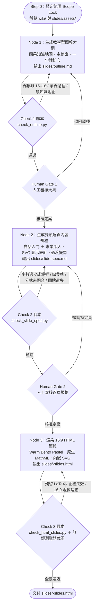

# LLM Wiki 2 — 跨領域計算機系統與資料結構知識庫

## 1. LLM Wiki 主題與簡短介紹

本專案參考 Andrej Karpathy 的 **LLM Wiki** 模式，建構一個「**原始資料唯讀、知識層由 Agent 全權編譯與交叉維護**」的個人研究與學習知識庫。目前聚焦於**計算機系統、超大規模資料中心架構、作業系統與資料結構**三大核心領域，並支援一鍵將知識庫內容轉化為 16:9 教學型 HTML 簡報。

### 目前知識庫收錄規模
- **7 份原始來源（`wiki/sources/docs/`）**：
  - *The Data Center as a Computer (4th Edition, 2026)*（Google WSC 專書）
  - *Operating System Concepts (10th Edition, 2018)* 與 9th Ed. 課程投影片（Ch 06 Memory、Ch 07 Virtual Memory、Ch 08 Mass Storage）
  - 資料結構課程投影片（Ch 03 Linked Lists、Ch 04 Stacks）
- **10 個核心概念（`wiki/concepts/`）**：涵蓋 WSC、Scale-Up vs. Scale-Out、Tail Latency、SDI、PUE/WUE、Virtual Memory & Paging、Mass Storage & RAID、Process Synchronization & Deadlocks、Linked Lists、Stacks & Backtracking。
- **4 個系統實體（`wiki/entities/`）**：Borg、Colossus、Spanner、TPU。
- **3 篇跨文比較（`wiki/comparisons/`）**：OS 9th vs. 10th Ed. 教材演進、單機 OS vs. WSC 儲存與排程典範轉移、Array vs. Linked List & Stack ADT 實作選擇比較（含 `> [!warning] 觀點衝突` 標記，絕不靜默覆蓋舊觀點）。

### 專案目錄結構
```text
LLM Wiki 2/
├── AGENTS.md                  # 知識庫核心運作規範（Batch Ingest / Query / Lint）
├── SLIDES_WORKFLOW.md         # HTML 簡報產製 State Graph 規範
├── .agents/workflows/         # /topic-slides 工作流與 Check 1–3 驗證腳本
├── raw/                       # 唯讀原始資料層（docs / web / notes / data）
├── wiki/                      # Agent 維護之知識層（index / log / sources / concepts / entities / comparisons）
├── assets/                    # 簡報圖貼總庫（Ingest / Lint 一律略過）
└── slides/                    # 可編輯中繼檔（outline.md / slide-spec.md）與最終 16:9 HTML 簡報
```

---

## 2. 簡報產製 Graph 流程圖與說明

為了避免 LLM 一次性生成長篇 HTML 簡報時出現偏題、爆框或公式失效，本專案將 `/topic-slides` 拆解為具備**雙人工確認閘門（Human Gates）**與**三道自動化驗證腳本（Check 1–3）**的 **State Graph** 流程：



### 各節點職責摘要
1. **Node 1（大綱與範圍鎖定）**：嚴格對齊使用者指定主題，規劃固定 **15–18 頁完整教學版**，建立「因果知識地圖」與每頁「一句話核心」，經 `check_outline.py` 與 **Human Gate 1** 核准後才推進。
2. **Node 2（雙軌內容與圖示規格）**：每頁採「**白話入門（生活比喻）＋ 專業深入（完整術語、公式、偽碼與實務代價）**」雙軌並陳，並在涉及程式碼、指標或演算法運作時標註內嵌 **SVG 圖示設計**，經 `check_slide_spec.py` 與 **Human Gate 2** 核准後才渲染。
3. **Node 3（16:9 HTML 渲染與檢查）**：輸出零外部 CDN 依賴的單檔 HTML（瀏覽器原生 **MathML `<math>`**、Warm Bento Pastel 視覺、`←` / `→` 鍵盤翻頁、無縫混合圖貼與教學 SVG），並保留 `slides/outline.md` 與 `slides/slide-spec.md` 方便日後局部修改重跑。

---


## 3. 快速開始指令與範例簡報

### Agent 常用操作指令

- **批次增量更新知識庫**：將新檔案（PDF、Markdown、筆記或 CSV）放入 `raw/` 對應子目錄後，向 Agent 下達 `/進行Batch Ingest`（或「掃描 `raw/` 更新 Wiki」）。
- **產製教學型 HTML 簡報**：向 Agent 下達 `/topic-slides`，鎖定主題範圍後依序通過 Human Gate 1（大綱）與 Human Gate 2（逐頁規格）即可產出 16:9 簡報。

#### 若想手動執行 Check 1–3 驗證腳本：（在下達 topic-slides 後原本就會自動跑）
```bash
# Check 1：大綱頁數（15–18 頁）、知識地圖、粒度與 wikilink 檢查
python3 .agents/workflows/scripts/check_outline.py slides/outline.md

# Check 2：逐頁字數上下限（260–1350 / Split 1150）、雙軌內容、公式平衡與圖貼檢查
python3 .agents/workflows/scripts/check_slide_spec.py slides/slide-spec.md --assets-dir slides/assets

# Check 3（靜態檢查）：圖片路徑、原生 MathML 與殘留 LaTeX 語法掃描
python3 .agents/workflows/scripts/check_html_slides.py slides/ds-linkedlist-stack-slides.html --static-only

# Check 3（完整視覺檢查，需先 pip install playwright && playwright install chromium）
python3 .agents/workflows/scripts/check_html_slides.py slides/ds-linkedlist-stack-slides.html --screenshot-dir /tmp/slides_check
```

### 範例 HTML 簡報（直接於瀏覽器開啟，支援 `←` / `→` 翻頁）
- [資料結構入門：Linked Lists 與 Stacks（16 頁雙軌教學＋SVG 指標圖示）](slides/ds-linkedlist-stack-slides.html)
- [OS 記憶體管理與虛擬記憶體入門（16 頁雙軌教學＋原生 MathML）](slides/os-memory-vm-slides.html)
- [Warehouse-Scale Computers 4th Ed. 導讀（16 頁原生 MathML）](slides/wsc-4thed-slides.html)
- [簡報視覺風格展示頁（Warm Bento Pastel 等四款主題比較）](slides/style-showcase.html)
