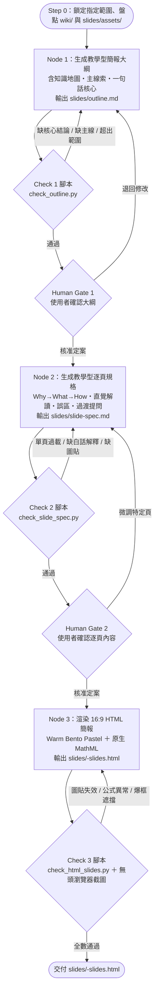

# SLIDES_WORKFLOW.md — Graph 式教學型 HTML 簡報產製規範

本文件為 `AGENTS.md` 之延伸規範，融合 `example/` 筆記的教學設計原則（**一句話核心、因果知識地圖、先動機後機制、直覺解讀、對比表與跨頁銜接提問**），定義 Agent 如何**嚴格根據使用者指定的內容範圍**，從 `wiki/` 知識庫打造**讓原本不熟悉該主題的人也能理解基本概念的教學型 16:9 HTML 簡報**。

---

## 1. 簡報產製 Graph 流程圖



---

## 2. 目錄與中繼檔保留規範

`slides/` 目錄下的中繼檔案與最終簡報**一併保留**，方便日後局部修改特定頁面後直接從 `Node 3` 重新渲染：

```text
slides/
├── assets/                   # 簡報圖貼副本（HTML 內統一使用 assets/<檔名>.jpeg 相對路徑）
├── outline.md                # Node 1 產出：教學型簡報大綱（含知識地圖與一句話核心）
├── slide-spec.md             # Node 2 產出：逐頁教學內容規格書（含直覺解讀與過渡提問）
└── <slug>-slides.html        # Node 3 產出：最終 16:9 HTML 簡報
```

---

## 3. 各節點任務、教學撰寫法與檢查規範

### Node 1：教學型大綱生成（`slides/outline.md`）
- **輸入**：使用者指定的**內容範圍（Scope）**、`wiki/index.md` 與範圍內相關頁面。
- **融合 `example/` 的大綱結構**：
  1. **總索引表與一句話核心**：對照 `example/00-總索引與知識地圖.md`，為每一頁寫出「一句話核心」。
  2. **因果知識地圖**：畫出頁與頁之間的邏輯推進箭頭（痛點動機 → 基本定義 → 運作機制 → 權衡與解法）。
  3. **貫穿全簡報的主線索**：點出 2–4 個跨頁反覆出現的核心概念，讓初學者掌握全局。
- **Check 1（`check_outline.py`）＋ Human Gate 1**：於大綱階段即先檢查 15–18 頁連續編號、因果知識地圖、每頁「一句話核心」、單頁概念粒度（字數上下限，避免過簡或單頁塞過多主題）、每頁 `[[wikilink]]` 與銜接提問、以及 `核心結論（Key Takeaways）`；**必須經使用者核准才可進入 Node 2**。

### Node 2：教學型逐頁內容規格（`slides/slide-spec.md`）
- **融合 `example/` 深入解說與「雙軌並陳：白話入門 ＋ 專業深入（由淺入深）」原則**：
  1. **生活比喻 ＋ 專業解說雙軌並陳**：每頁畫面同時保留「**白話入門**」（生活比喻與口語定義，讓初學者看得懂）與「**專業深入**」（完整英文術語、底層硬體機制、位元/暫存器細節、演算法步驟與實務代價），**單頁內容須充實、不可過於單薄**。
  2. **Why → What → How 順序**：先講「如果沒有它會發生什麼問題（動機）」，再用白話定義「它是什麼」，最後才展開「如何運作」。
  3. **術語白話化與公式直覺解讀**：首次出現英文縮寫或專有名詞（如 `TLB`、`PUE`、`Page Fault`、`Banker's Algorithm`）必附一句白話定義；每個數學公式／架構圖旁必附變數翻譯、「**直覺解讀**」與具體數字範例。
  4. **對比矩陣與誤區標記**：易混淆概念採對比表格呈現，並以「🔑 核心直覺」與「⚠️ 常見誤區」（例如 `不安全 ≠ 死結`）點出關鍵。
  5. **跨頁銜接提問**：在頁尾留一句引出下一頁的「過渡提問」，建立連續閱讀節奏。
  6. **版面、圖示與圖貼配置**：同時控制單頁字數**下限與依版面分級之上限**（防止內容太少顯得空洞，也防止含圖貼／Split 版面在 16:9 爆框）；講解程式碼、指標操作、記憶體配置或演算法步驟時，**可以適當搭配 SVG 圖示**（於規格書加註 `圖示設計`），並指定 `assets/<檔名>.jpeg` 位置與 `[[wikilink]]` 溯源。
- **Check 2（`check_slide_spec.py`）＋ Human Gate 2**：前置檢查單頁字數上下限（含 `白話入門` / `專業深入` 雙軌各別字數下限與 Split/圖貼分級上限）、`過渡提問`、公式 `$` / `$$` 括號平衡、`[[wikilink]]` 與 `assets/` 圖貼存在性；**必須經使用者核准才可進入 Node 3**。

### Node 3：HTML 投影片渲染（`slides/<slug>-slides.html`）
- **技術與風格標準**：
  - **版面與操作**：16:9 單頁投影片模式，支援鍵盤 `←` / `→`、`PageUp` / `PageDown`、`Space` 翻頁，並附底部進度條與快速跳頁選單。
  - **視覺風格與圖示**：預設採用 **Warm Bento Pastel**（暖米白畫布搭配柔橘、抹茶綠、柔粉卡片），圖貼使用 `mix-blend-mode: multiply` 與柔邊遮罩（Radial Mask）自然融入背景；指標與演算法運作頁面**可以適當內嵌 SVG 圖示**輔助理解。
  - **數學公式**：一律編譯為瀏覽器原生 **MathML（`<math>`）**，不依賴外部 CDN（確保 `file://` 本機離線開啟 100% 正常渲染，且不與 `$47,000` 等金額符號衝突）。
- **Check 3（`check_html_slides.py` ＋ 無頭瀏覽器逐頁截圖檢查）**：
  1. **靜態檢查**：掃描 HTML 確認無殘留未轉譯的 `$...$` LaTeX 語法，且所有 `src="assets/..."` 皆對應實體圖檔。
  2. **無頭瀏覽器逐頁截圖檢查**：使用 Playwright / Chromium 以 16:9 視口（`1280x720`）實際開啟並按 `ArrowRight` 逐頁截圖，確認無文字溢位、公式排版正常、邊角圖貼載入且不遮擋內文；若任一頁異常，僅局部修復該頁並重跑 Check 3。
